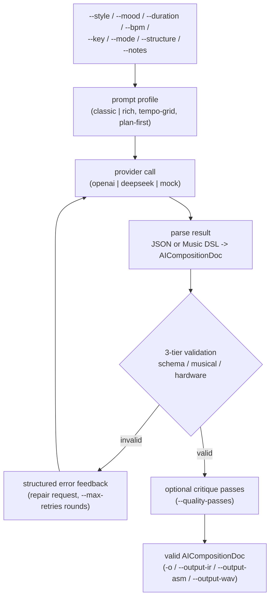

# AI Composition Layer

The `ai/` package implements everything between "a prompt" and "a validated `AICompositionDoc`". Its
scope is deliberately narrow — *composition only* — so AI can never compromise the hardware guarantees
that the rest of the pipeline enforces.

## Internal structure

`src/atari_music/ai/` ([module tree](https://github.com/grzes71/atari-music-composer/tree/main/src/atari_music/ai)):

| Module | Responsibility |
| --- | --- |
| `schema.py` | `AICompositionDoc` v1 schema and `ValidationReport` (pydantic) |
| `dsl.py` | Lossless Music DSL parser & serializer (`parse_music_dsl`, `export_music_dsl`) |
| `validation.py` | 3-tier validator: schema, musical rules, POKEY hardware constraints |
| `composition.py` | `AICompositionDoc` → `MusicSong` / `IRSong` compiler |
| `prompts.py` / `prompt_library.py` | `classic` and `rich` prompt profiles, timing grid, rhythmic density targets |
| `critique.py` | `MusicalCritique` and rhythmic-density scoring for `--quality-passes` |
| `client.py` | AI retry/repair loop, composition loaders, `build_xex_from_result()` |
| `analysis.py` | Musical/hardware metrics, per-role rhythm, SHA-256 `fingerprint()` |
| `structure_analysis.py` | Repetition ratio, motif reuse, formal structure deduction |
| `providers/` | `MockAICompositionProvider` and `OpenAICompositionProvider` (also used for DeepSeek endpoints) |

## Request lifecycle

## Design decisions worth knowing

* **The AI emits documents, not register data.** The model writes `AICompositionDoc` JSON or Music DSL —
  never `AUDF` values or envelopes. Hardware realization is applied by the catalog/planner stage with
  deterministic checks. This is what makes the AI layer *trustworthy enough to accept by default*.
* **The repair loop is validation-driven.** When validation fails, the provider receives the structured
  errors (schema paths, rule IDs like `BASS16_CHANNEL_CONFLICT`) for up to `--max-retries` (default 3)
  rounds, instead of the caller guessing how to prompt around the failure.
* **The DSL exists for token efficiency.** Music DSL maps losslessly into the document while cutting
  ~49.4 % of LLM tokens in empirical 100-trial runs (and ~83 % of raw tokenizer tokens on static
  examples) — see the [Music DSL specification](../reference/music-dsl.md) with EBNF grammar and
  benchmarks.
* **Prompt engineering is versioned as profiles.** `--prompt-profile rich` adds a timing grid, chiptune
  craft guidance, style idioms, and a richer example; `--tempo-grid exact` suggests PAL-grid BPMs;
  `--plan-first` requests a structured `MusicalBrief` plan before notes.
* **Quality passes are separate from validity.** `--quality-passes N` runs musical critique
  (`critique.py`) and feeds revisions back — strictly *after* the song is already valid.

## Mock provider as first-class citizen

`MockAICompositionProvider` is not a stub for tests only — it is the documented offline entry point
(`ai-compose --provider mock`) producing deterministic, fully validated compositions. Because it runs
the exact same parse/validate/compile path, demos and CI exercise the whole pipeline with zero network
dependencies.

## Consume the result

The document flows into the standard pipeline (see [pipeline](pipeline.md)): save it as your master
composition (`-o song.json`) and iterate via [arrangement](../user-guide/arrangement.md), or export
directly with `ai-compose --output-ir/--output-asm/--output-wav`. `analyze`
([`ai/analysis.py`](https://github.com/grzes71/atari-music-composer/blob/main/src/atari_music/ai/analysis.py))
provides per-role rhythm metrics, hardware utilization, the SHA-256 musical fingerprint, and — with
`--structure` — deduced form (repetition ratios, motif reuse).
