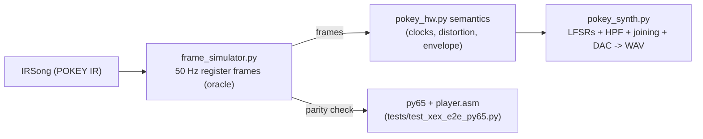

# Audio Engine & POKEY Synthesis

The audio engine is the part of the project that must be *right*, not just useful: if the preview lies,
every downstream decision (arrangement choices, listening tests, catalog curation) is built on sand.
The engine therefore simulates POKEY at the register/LFSR level and renders the digital path exactly.

## Source of truth: `pokey_hw.py`

[`pokey_hw.py`](https://github.com/grzes71/atari-music-composer/blob/main/src/atari_music/pokey_hw.py)
is the single module through which all "musical intent → POKEY register value" conversions must pass —
codec for `AUDC` distortion decoding, clock/divider arithmetic (`hz_from_audf_*`, `audf_from_hz_*`),
the tracker `AUDF` clamp, and the ADSR envelope that `player.asm` reproduces. Its behavior is verified
against two independent reference emulators (atari800 `pokeysnd.c` by Ron Fries and `mzpokeysnd.c` by
Borisov/Nikiel), which is why the WAV renderer and the 6502 export cannot drift apart.

## Clocks and frame timing

Defined in [`constants.py`](https://github.com/grzes71/atari-music-composer/blob/main/src/atari_music/constants.py),
the system targets **PAL** machines:

| Clock | Value | Used for |
| --- | --- | --- |
| `PAL_CLOCK_HZ` | 1,773,447 Hz | master clock |
| `PAL_64KHZ_CLOCK` | `PAL/28` ≈ 63,920.89 Hz | default base clock for `AUDF` dividers |
| `PAL_15KHZ_CLOCK` | `PAL/114` ≈ 15,696.0 Hz | 15 kHz mode (`AUDCTL $01`) |
| 1.79 MHz | `PAL_CLOCK_HZ` (~1.77 MHz on PAL) | `AUDCTL $40` (CH1) / `$20` (CH3) fast clocks |

Register updates are quantized to 50 Hz VBLANK frames — the player writes registers directly from
pre-computed music data, which is why the stepper lives at integer 8-bit granularity.

## Distortion decoding (AUDC bits 5–7)

`AUDC` carries volume in bits 0–3 and distortion in bits 4–7. The engine encodes the audibly relevant
facts, including the classic surprises:

| `AUDC` base | Meaning |
| --- | --- |
| `$00` | poly5-gated poly9/17 (gated noise) |
| `$20` / `$60` | poly5-gated pure tone (buzzy) — audibly identical |
| `$40` | poly5-gated poly4 |
| `$80` | poly9/17 direct — the **only** true ungated noise mode |
| `$A0` / `$E0` | pure tone (clean square) — `PURETONE` outranks `POLY4`, so `$E0` is *not* white noise |
| `$C0` | poly4 direct (15-step buzz) |

These equivalences matter in practice: e.g. the historical `lead_c1_octave_pulse` bug (fixed in v0.17.1)
came from real `$40` LFSR subharmonic collapse at standard dividers — the fix was switching to `$A0`
pure tone. Exactly this class of trap is why `pokey_hw.py` documents and tests the decode table.

## LFSR-exact WAV synthesis (`pokey_synth.py`)

[`pokey_synth.py`](https://github.com/grzes71/atari-music-composer/blob/main/src/atari_music/pokey_synth.py)
renders 50 Hz register frames to 16-bit PCM mono 44.1 kHz WAV by simulating the chip itself:

* **POLY4** — 15-step counter LFSR including the modulo-3/5 stall behavior,
* **POLY5** — 31-step LFSR used as a gate/XNOR mask,
* **POLY9** — 511-step and **POLY17** — 131071-step noise sequences,
* **HPF XOR latches** — `AUDCTL $02` (CH2 clocked by CH4) and `$04` (CH1 clocked by CH3),
* **16-bit channel joining** — `AUDCTL $10` (CH1 master + CH2 slave) and `$08` (CH3+CH4),
* **non-linear resistor-ladder DAC** (`POKEY_DAC`) instead of a naive linear conversion.

As of the XEX v2 promotion work, songs requiring v2 features automatically render through
`simulate_ir_song_frames(..., format_version=2)`, so macros/pitch envelopes/program changes are audible
in previews (WAV preview tiers are declared alongside the XEX targets in `instruments/runtime.py`).

## The frame oracle (`frame_simulator.py`)

[`frame_simulator.py`](https://github.com/grzes71/atari-music-composer/blob/main/src/atari_music/frame_simulator.py)
implements the v1 and v2 per-frame state machines (envelope phases, macro stepping, pitch-envelope
arithmetic, program changes, joined-divider math) in plain Python. Its outputs are compared in tests
**bit-exactly** against `player.asm` running in `py65` on the assembled production `.xex`. The oracle
thus serves three purposes at once: (1) it renders previews, (2) it defines correct behavior for the
6502 implementation, and (3) it lets tests verify the real player without a real Atari.

## How the pieces align

For the 6502 side of the story, see [6502 Player & XEX Export](player-xex.md); for the register-level
song binary, [Song Format v2](../reference/song-format-v2.md).
