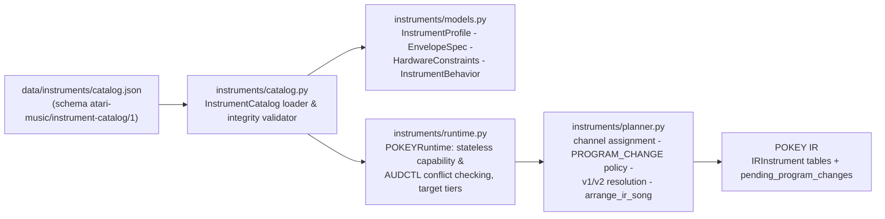

# Instrument System

The Stage A–E instrument architecture introduced an opt-in, hardware-validated layer on top of the
legacy rendering path. It answers a concrete failure mode of chip-music tooling: instruments that sound
fine in an emulator, then break on hardware — or worse, quietly consume two channels/join bits behind
the composer's back.

## Why a catalog at all?

Because POKEY validity is *relational*: a sound is valid only in a context (which channels are joined,
which clock is selected, which `AUDCTL` bits are required). A catalog entry therefore declares hard
`hardware_constraints` (`channels_allowed`, `divider_mode`, `required_audctl_bits`,
`forbidden_audctl_bits`, `midi_range`), and a *stateless* runtime checks combinations at assignment
time.

## Components

| Component | Role |
| --- | --- |
| [`instruments/models.py`](https://github.com/grzes71/atari-music-composer/blob/main/src/atari_music/instruments/models.py) | Frozen pydantic v2 models. `EnvelopeSpec` is the static linear 4-phase ADSR matching `player.asm`; `HardwareConstraints` separates *advisory* clock preference (`preferred_clock_hz`) from *hard* POKEY constraints |
| [`instruments/catalog.py`](https://github.com/grzes71/atari-music-composer/blob/main/src/atari_music/instruments/catalog.py) | Loads and validates the catalog JSON: schema id, behavior links, provenance, cross-field hardware rules (e.g. `divider_mode` vs `required_audctl_bits`, macro step limits) |
| [`instruments/runtime.py`](https://github.com/grzes71/atari-music-composer/blob/main/src/atari_music/instruments/runtime.py) | `POKEYRuntime` — stateless checks for a *set* of assignments: channel locks, clock compatibility (`64khz`, `15khz`, `1.79mhz`), 16-bit pair locks, and runtime-tier gates per export target (`xex_v1`, `xex_v2`, `wav`; SAP targets are declared but intentionally not implemented) |
| [`instruments/planner.py`](https://github.com/grzes71/atari-music-composer/blob/main/src/atari_music/instruments/planner.py) | `arrange_ir_song` and friends: apply `--channel-instrument` assignments with `--program-change-policy` (`preserve`/`replace`/`remove`), resolve v1 vs v2 (incl. explicit per-channel vibrato-clearing warnings when a v1 song is promoted to v2), and emit the re-instrumented IR |

## Instrument profiles and behaviors

A profile (`InstrumentProfile`) is the identity of a sound: `instrument_id`, `display_name`, `version`,
`family`, `intended_roles`, `base_distortion`, `envelope`, `waveform_family`, `hardware_constraints`,
`behavior_id`, and `provenance`. A behavior (`InstrumentBehavior`) is the time-varying machinery:
`modulation_mode` (currently `none` or `octave_pulse`), optional `transient_macro` (1–8 steps of
`duration_frames`, `distortion_nibble`, `audf_offset`/`fixed_audf`, `volume`), optional `pitch_envelope`
(`start_audf_delta`, `duration_frames`, `step_delta`), and `required_runtime_tier`:

| Runtime tier | Semantics | Deliverable |
| --- | --- | --- |
| `core_v1` | Static ADSR / octave-pulse modulation | playable on `xex_v1`, `xex_v2`, `wav` |
| `core_v2_iter1` | 50 Hz transient macros + pitch envelopes | `xex_v2` + WAV (v2 frame simulation) |
| `core_v2_iter2` | Delayed vibrato, pitch slides, arpeggios | deferred — blocked on all targets |
| `experimental_deferred` | HPF XOR PWM, bell arps | explicitly blocked (`[DEFERRED_FEATURE]`) |
| `wav_only` | Preview-only profiles | WAV preview, never XEX |

The current 16 profiles and the usage CLI are described in the [user-facing instruments page](../user-guide/instruments.md);
the procedure for adding new entries is in [Adding New Instruments](../development/adding-instruments.md).

## How assignments stay honest

At arrangement time the planner asks `POKEYRuntime` for every conflicting pair **before** any IR is
modified; failures name the exact rule (channel conflict, clock mismatch, tier gate,
`TARGET_FORMAT_CONFLICT`). There are no silent fallbacks: if a requested instrument cannot run on the
chosen target, the command fails. This keeps the triad *composition → arrangement → export* debuggable:
a problem is always attributable to one validated decision point.

## Backward compatibility

Songs without `--channel-instrument` / `--use-instrument-catalog` behave exactly like pre-Stage-A
releases and keep exporting `SONG_FORMAT_VERSION = 1`. The legacy sound-profile bank
(`--sound-bank`/`--profile-bindings`) and Lead Library v0.1 (`--instrument PART=ID`) remain functional
alongside the catalog (see [Sound Profile Integration](../reference/profile-integration.md)).
