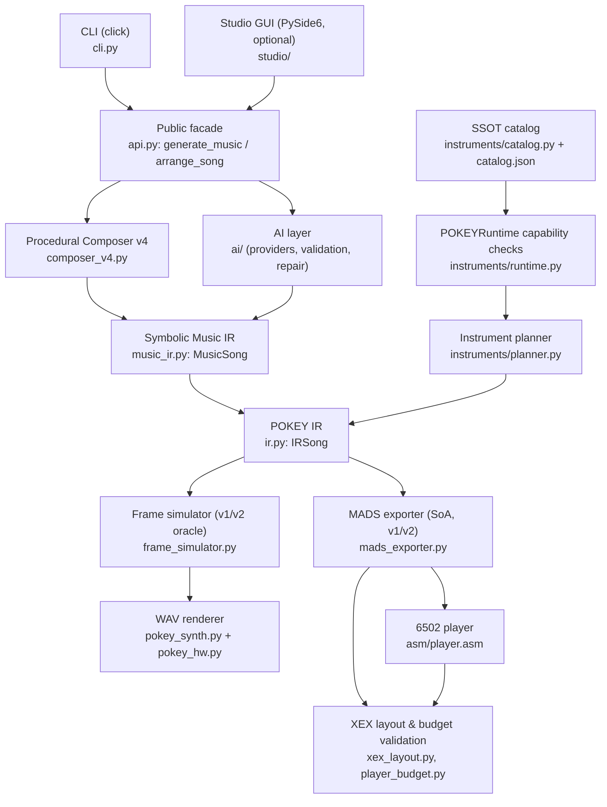

# System Overview

Atari Music Composer exists to solve a problem that is easy to state and hard to execute: **given only
the 4-channel POKEY chip on a 1.79 MHz 6502, produce game-ready music that survives contact with real
hardware.** The architecture encodes three decisions that make this tractable.

## Design principles

1. **Separate composition from realization.** A composition (notes, rhythm, form, harmony) must be a
   stable artifact that survives sound-design iteration. Instrument realization (waveforms, envelopes,
   macros, clock routing) is applied later, per arrangement. This is why a song can be re-voiced into
   multiple `.xex` builds without re-invoking an LLM — and why AI is strictly a *compositional* tool
   here, never a synthesis tool.
2. **One hardware-semantics source of truth.** Everything that turns musical intent into POKEY register
   values goes through `pokey_hw.py` (distortion decoding, clock/divider arithmetic, envelope shape).
   The Python WAV renderer and the 6502 export path are guaranteed to agree by construction — they
   cannot drift apart because they share the same semantics module, and the frame simulator proves the
   parity in tests.
3. **Fail loudly, never silently degrade.** Incompatible instrument assignments, oversized players,
   out-of-bounds XEX segments, unsupported format mixes — all are hard errors. The catalog explicitly
   marks *deferred* instruments (`[DEFERRED_FEATURE]`) instead of letting them half-work.

## High-level architecture

Everything above `MUSIC IR`/`POKEY IR` is musical; everything below is hardware bound. The CLI and the
Studio GUI are interchangeable front ends over the same facade.

## Module map

[`src/atari_music/`](https://github.com/grzes71/atari-music-composer/tree/main/src/atari_music) —
core package (src layout):

| Module | Responsibility |
| --- | --- |
| `api.py` | Public facade: `generate_music()`, `arrange_song()`, `MusicGenerationResult` |
| `cli.py` | Click CLI entrypoint (`atari-music` / `python -m atari_music`) |
| `config.py` | 4-tier `.env` / env / CLI configuration resolution and secret masking |
| `composer_v4.py` | Procedural 4-channel Composer v4 (profiles, counterpoint, bass, rhythm) |
| `music_ir.py` | Symbolic Music IR (`MusicSong`) |
| `ir.py` | Hardware POKEY IR (`IRSong`), v1/v2 frame sizing and stream planning |
| `frame_simulator.py` | Python frame oracle implementing the v1 & v2 50 Hz state machines |
| `pokey_hw.py` | Hardware-exact POKEY LFSRs, clocks, and envelope semantics (SSOT) |
| `pokey_synth.py` | 44.1 kHz WAV renderer (LFSRs, HPF XOR, 16-bit joining, DAC) |
| `mads_exporter.py` | Relocatable SoA MADS exporter (Format v1 & v2 + validator) |
| `player_budget.py` | MADS compilation check enforcing the < 2048 B player budget |
| `xex_layout.py` | XEX parser and `$0400–$BFFF` disjoint-segment layout verifier |
| `asm/player.asm` | Relocatable MOS 6502 player (v1 + v2 macro & pitch engines) |
| `instruments/` | SSOT instrument architecture ([details](instrument-system.md)) |
| `studio/` | Studio headless services + optional PySide6 UI ([usage](../user-guide/studio.md)) |
| `ai/` | AI composition & analysis layer ([details](ai-layer.md)) |
| `sound_profiles/` | Legacy/research Stage 9 `SoundProfileBank` and binding loader |

Research/experiment engines (`stage*.py`, `pokey_timbre_*.py`, `listening_test*.py`, …) exist alongside
the production package and back the research commands; they are covered by the
[Research programme](../research/index.md) and are deliberately not on the production path.

## Why three representations (and counting)

`AICompositionDoc` is the interchange/SSOT format (validated, human-readable, LLM-friendly).
`MusicSong` (symbolic IR) is the analysis-friendly form. `IRSong` (POKEY IR) is the hardware-compiled
form — divider parameters, resolved instruments, program changes — from which both renderers derive.
Conversions are one-way pipelines with validation at every boundary (see
[Music Generation Pipeline](pipeline.md)). The binary song formats v1/v2 on the Atari side are merely
serialized `IRSong` tables (see [Song Format v2](../reference/song-format-v2.md)).

See the deep-dives:

* [Music Generation Pipeline](pipeline.md)
* [Instrument System](instrument-system.md)
* [Audio Engine & POKEY Synthesis](audio-engine.md)
* [6502 Player & XEX Export](player-xex.md)
* [AI Composition Layer](ai-layer.md)
