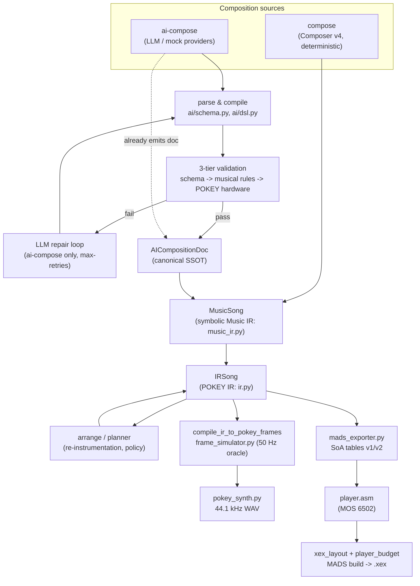

# Music Generation Pipeline

This page follows a composition through the pipeline stage by stage — what each stage adds, why it
exists, and where its outputs are consumed.

## The full pipeline

## Stage by stage

**1. Composition sources.** `compose` runs Composer v4 (deterministic, profile-driven: six profiles,
bass/counterpoint/percussion engines, optional 16-bit bass coupling). `ai-compose` asks a provider
(`openai` / `deepseek` / offline `mock`) for either canonical JSON or Music DSL. Both paths exist
because procedural output is reproducible and cheap while AI output is expressive but requires
validation — the pipeline is built to make both first-class.

**2. Parse & compile.** Music DSL is compiled losslessly by `parse_music_dsl()` (in
[`ai/dsl.py`](https://github.com/grzes71/atari-music-composer/blob/main/src/atari_music/ai/dsl.py))
directly into `AICompositionDoc`, reporting exact line/column errors. JSON files are loaded into the
same pydantic models. There is no second musical model — the DSL is purely a frontend.

**3. 3-tier validation.** [`ai/validation.py`](https://github.com/grzes71/atari-music-composer/blob/main/src/atari_music/ai/validation.py)
checks (a) schema consistency, (b) musical grammar (channel monophony, `BASS16_CHANNEL_CONFLICT`, …),
and (c) POKEY hardware constraints. Validation exists because the primary producers of compositions are
*untrusted text writers* — humans and LLMs. Failing documents from `ai-compose` are sent back to the
model with structured errors for up to `--max-retries` rounds.

**4. Symbolic Music IR (`MusicSong`, `music_ir.py`).** The composition compiler
([`ai/composition.py`](https://github.com/grzes71/atari-music-composer/blob/main/src/atari_music/ai/composition.py))
turns the document into notes with pitches, durations, volumes; analysis modules (harmony, rhythm,
contour) operate here, before any hardware decision.

**5. POKEY IR (`IRSong`, `ir.py`).** The compiler resolves every note into `AUDF` divider values for
the configured clock, attaches `IRInstrument` realizations (v1 envelopes/modulation or v2 transient
macros and pitch envelopes), plans the 50 Hz frame stream, and records
`initial_channel_instruments` and per-note `pending_program_changes`. This is the pivot artifact: WAV
and XEX both derive from it, which is the structural guarantee that *the preview equals the artifact*.

**6. Arrangement.** [`instruments/planner.py`](https://github.com/grzes71/atari-music-composer/blob/main/src/atari_music/instruments/planner.py)
(`arrange_ir_song`) re-instruments the IR: channel assignments, `PROGRAM_CHANGE` policies, v1/v2
resolution. Musical content is untouched (`_load_song_input_for_arrange()` accepts JSON only),
preserving the composition fingerprint by construction.

**7. Frame simulation & WAV.** `frame_simulator.py` is the *oracle*: a Python implementation of the
exact v1/v2 state machines that `player.asm` runs — ADSR envelopes, macro stepping, pitch envelopes,
program changes, 16-bit joining. `compile_ir_to_pokey_frames()` produces the 50 Hz register stream;
`pokey_synth.py` resynthesizes it to 44.1 kHz WAV. `py65` tests assert bit-exact
`$D200–$D208` parity between this oracle and the real assembled player.

**8. MADS & XEX.** `mads_exporter.py` serializes the IR into Structure-of-Arrays tables (format v1 or
v2, auto-selected), emits the relocatable song data for `player.asm`, and the MADS assembler produces
the `.xex`; `xex_layout.py` and `player_budget.py` verify the container and the 2 KB player budget
before the binary is accepted (details in [6502 Player & XEX Export](player-xex.md)).

## Determinism and reproducibility

* `compose` is seeded — same flags, same song.
* `ai-compose --provider mock` is deterministic and offline.
* `arrange` is deterministic given (composition, catalog, flags) and never consumes AI.
* Verification keys (`analyze`, fingerprint, `arrangements.log` in the batch runner) let you prove two
  artifacts share the same musical content.
