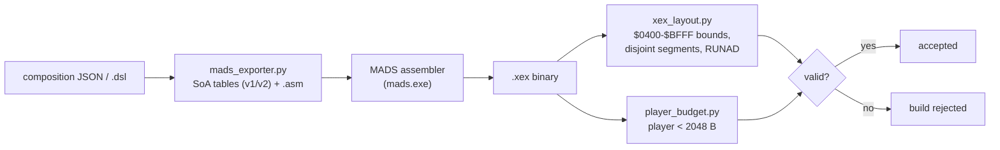

# 6502 Player & XEX Export

The runtime story of Atari Music Composer is a relocatable pure MOS 6502 player
([`src/atari_music/asm/player.asm`](https://github.com/grzes71/atari-music-composer/blob/main/src/atari_music/asm/player.asm))
that plays both the legacy v1 format and the macro-enabled v2 format, plus a build chain that refuses to
ship binaries violating the project's hardware rules.

## Design requirements

* **Relocatable** — the player links at `--player-address` (default `$6000`), music data at
  `--music-address` (default `$8000`), and only 10 Zero Page bytes from `--zp-base` (default `$80`,
  i.e. `$80..$89`); the on-screen harness keeps its display pointers at `$8A..$8D` so the player can be
  dropped into a game anywhere within `$0400–$BFFF`.
* **Small** — the player (code + BSS state) is measured by
  [`player_budget.py`](https://github.com/grzes71/atari-music-composer/blob/main/src/atari_music/player_budget.py)
  on every build and must stay **< 2048 bytes**. It currently measures **1785 bytes** (263 bytes of
  headroom), a hard constraint for games that also need the player's screen harness.
* **Official 6502 only** — no 65C02/65816 instructions, so binaries run on any stock XL/XE.
* **Self-verifying** — the player rejects invalid data (unsupported `format_version`, instrument counts
  above `MAX_V2_INSTRUMENTS = 32`, invalid opcodes or `PROGRAM_CHANGE` targets) by muting cleanly, and
  enforces `MAX_V2_PARSE_COMMANDS = 8` per tick against corrupt streams.

## Song formats v1/v2

The music data is a Structure-of-Arrays serialization of `IRSong`
([exporter](https://github.com/grzes71/atari-music-composer/blob/main/src/atari_music/mads_exporter.py)).
Format v1 carries up to 4 static channel instruments (ADSR + `MOD_OCTAVE_PULSE`). Format v2 adds: up to
32 instruments, a deduplicated transient-macro directory (1–8 steps × 4 bytes), signed 8-bit pitch
envelopes, initial `CH1..CH4` assignment, and 4-byte `OPCODE_PROGRAM_CHANGE` events. The full byte
layout, opcodes, validation rules, and measured cycle/resource profile are specified in
[Song Format v2](../reference/song-format-v2.md).

`--player-version auto` keeps v1 when the song fits it (this preserves byte-compatibility for legacy
songs) and selects v2 only when v2 features are actually present.

## Build chain and hard validation

The guarantees, restated from the [export guide](../user-guide/export.md):

1. **Player budget** — `player_budget.check_player_size()` compiles the player and fails the build if
   code + BSS exceed 2048 bytes.
2. **Memory bounds** — every load segment must lie strictly within `$0400–$BFFF` (the `$A000–$BFFF`
   BASIC ROM window is deliberately allowed for game use; OS kernel `$C000–$CFFF`, I/O `$D000–$DFFF`,
   OS ROM `$E000–$FFFF`, Zero Page, stack, and OS vectors are forbidden).
3. **Disjoint segments** — overlapping XEX segments are rejected immediately.
4. **Runtime guards** — the player itself validates the data it is given and fails safe (mute) rather
   than corrupting memory.

## Verification pyramid

Production `.xex` binaries are verified in three tiers (full guide:
[XEX Verification](../reference/xex-verification.md)):

1. **`py65` end-to-end** (`tests/test_xex_e2e_py65.py`, marker `core`) — boots the *exact* `.xex`
   through a DOS-style segment loader (`INITAD`/`RUNAD`), simulates VBLANK, captures committed
   `$D200–$D208` POKEY snapshots, and asserts bit-exact register parity with `frame_simulator.py` for
   v1, v2 8-bit, and v2 16-bit songs. Monitors for illegal writes outside the allowed GTIA/POKEY/ANTIC
   registers and enforces bounded cycle limits.
2. **Altirra full-system** (`tests/test_xex_altirra.py`, optional `emulator` marker) — boots real
   binaries in `AltirraSDL` (PAL 800XL) through `AltirraBridge` when available locally: real screen
   output, keyboard, PAL `RTCLOK`, audio trace.
3. **Real hardware checklist** — the manual XL/XE checklist documented alongside the verification spec.

## History note

The v2 player extension was drafted with explicit byte accounting —
`reference/c1-player-extension-design.md` (C1 octave pulse) weighs +88 B of player against per-note
effect alternatives (+399 B on the reference song). That discipline (measure the 6502 cost before
committing to a format feature) is why the format v2 design stores per-instrument descriptor bytes and
a shared macro directory, and why the player stayed under budget while gaining macros, pitch envelopes,
and `PROGRAM_CHANGE`.
