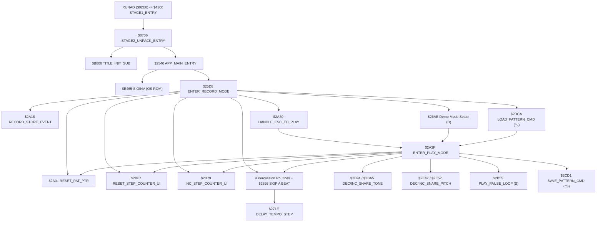

# Phase B — Rhytmizer 6502 Disassembly & Code Analysis

- **Companion complete annotated disassembly:** [`docs/reverse_engineering/rhytmizer_disassembly.asm`](rhytmizer_disassembly.asm)
- **Source binary:** `rhytmizer.xex` (`6,333` bytes)
- **Disassembly coverage:** 100% of executable code across all three runtime code regions:
  1. Stage 1 Bootloader/Relocator (`$4300–$432A`, 43 bytes)
  2. Stage 2 Descriptor Unpacker (`$0706–$0798`, 147 bytes, plus descriptor table `$079F–$0804`)
  3. Splash Screen Init (`$B800–$B80F`, 16 bytes) and Main Application & Sound Engine (`$2540–$2E5C`, 2,333 bytes)

---

## 1. Subroutine Inventory & Call Graph

### 1.1 Complete Subroutine Boundaries

| Start–End | Symbol | Size | Category | Description |
| :---: | --- | :---: | --- | --- |
| `$4300–$432A` | `STAGE1_ENTRY` | 43 B | Bootloader | Copies `$2A80–$437F` (`$1900` bytes) to `$0700–$1FFF`, clears `CASINI`/`DOSINI`, calls `$0706`. |
| `$0706–$0798` | `STAGE2_UNPACK_ENTRY` | 147 B | Bootloader | Processes 17 backward block-copy descriptors at `$079F–$0804`, calls `$B800`, jumps to `$2540`. |
| `$B800–$B80F` | `TITLE_INIT_SUB` | 16 B | UI / Init | Points `SDLSTL/H` (`$0230/$0231`) to `$B810` and sets `COLOR2` (`$02C6`) to `$90`. Returns via `RTS`. |
| `$2540–$2570` | `APP_MAIN_ENTRY` | 49 B | Init | Calls `SIOINV ($E465)`, sets `AUDCTL=$00`, `SKCTL=$03`, `COLOR4=$00`, `COLOR2=$00`, `SDLSTL/H=$24F2`, `$2002=$07`, `$2005=$16`, `$2006=$01`, jumps to `$25D8`. |
| **`$2571–$25D7`** | **`TRIG_SNARE`** | **103 B** | **Sound** | **Synthesizes `3>SNARE` (Key `$1A`) on CH1+CH2 (`AUDCTL=$01`) and flashes UI indicator at `$2086`.** |
| `$25D8–$26CD` | `ENTER_RECORD_MODE` | 246 B | Sequencer / UI | Switches DLIST mode line to `MODE=RECORD` (`$23CB`), resets step counter and flags (`$2009=0`, `$200A=0`), polls `CH ($02FC)`, records & triggers keys. |
| **`$26CE–$271D`** | **`TRIG_HH_CLOSED`** | **80 B** | **Sound** | **Synthesizes `1>HH CLOSED` (Key `$1F`) on CH1+CH2 (`AUDCTL=$00`) and flashes UI indicator at `$2036`.** |
| **`$271E–$272D`** | **`DELAY_TEMPO_STEP`** | **16 B** | **Timing** | **Shared blocking CPU delay loop: executes `256 * $2002` inner Y-loops (`11 + 1805 * $2002` CPU cycles).** |
| **`$272E–$2797`** | **`TRIG_BASS_DRUM`** | **106 B** | **Sound** | **Synthesizes `SPACE>BASS DRUM` (Key `$21`) on CH1+CH2 (`AUDCTL=$01`) and flashes UI indicator at `$20AE`.** |
| **`$2798–$27F2`** | **`TRIG_HH_ACCENT`** | **91 B** | **Sound** | **Synthesizes `2>HH ACCENT` (Key `$1E`) on CH1+CH2 (`AUDCTL=$00`) and flashes UI indicator at `$205E`.** |
| **`$27F3–$2843`** | **`TRIG_CLAPS`** | **81 B** | **Sound** | **Synthesizes `8>CLAPS` (Key `$35`) on CH1 (`AUDCTL=$00`; `$2821` bug writes `$D5EB`) and flashes UI indicator at `$2176`.** |
| **`$2844–$2894`** | **`TRIG_WOOD_BLOCK`** | **81 B** | **Sound** | **Synthesizes `7>WOOD BLOCK` (Key `$33`) on CH1+CH2 (`AUDCTL=$00`) and flashes UI indicator at `$214E`.** |
| **`$2895–$28D1`** | **`TRIG_SKIP_A_BEAT`** | **61 B** | **Sound / Rest** | **Executes 9 silent delay steps (`*>SKIP A BEAT`, Key `$07`) keeping `AUDC1=0`, `AUDC2=0`, `AUDCTL=0`.** |
| **`$28D2–$2936`** | **`TRIG_TOM_1`** | **101 B** | **Sound** | **Synthesizes `4>TOM 1` (Key `$18`) on CH1+CH2 (`AUDCTL=$01`) and flashes UI indicator at `$20D6`.** |
| **`$2937–$299B`** | **`TRIG_TOM_2`** | **101 B** | **Sound** | **Synthesizes `5>TOM 2` (Key `$1D`) on CH1+CH2 (`AUDCTL=$01`) and flashes UI indicator at `$20FE`.** |
| **`$299C–$2A00`** | **`TRIG_TOM_3`** | **101 B** | **Sound** | **Synthesizes `6>TOM 3` (Key `$1B`) on CH1+CH2 (`AUDCTL=$01`) and flashes UI indicator at `$2126`.** |
| `$2A01–$2A17` | `RESET_PAT_PTR` | 23 B | Sequencer | Sets `ZP_PAT_PTR ($CC/$CD)` to `$2E5D` if `$200A != 0` (Demo Mode) or `$333C` if `$200A == 0` (User Mode). |
| `$2A18–$2A2F` | `RECORD_STORE_EVENT` | 24 B | Sequencer | Stores accumulator `A` (keycode) at `($CC),Y` (`Y=0`), increments `$CC/$CD`, and sets `$2009 = $01`. |
| `$2A30–$2A3E` | `HANDLE_ESC_TO_PLAY` | 15 B | Sequencer | If `$2009 == 0`, jumps back to `$25D8`; otherwise appends `$64` end-of-pattern marker via `JSR $2A18` and falls through to `$2A3F`. |
| `$2A3F–$2B66` | `ENTER_PLAY_MODE` | 296 B | Sequencer | Switches DLIST mode line to `MODE=PLAY` (`$23F3`), resets pattern pointer & step counter, loops through `($CC),Y` calling instrument subroutines and polling `CH ($02FC)` for live controls. |
| `$2B67–$2B78` | `RESET_STEP_COUNTER_UI` | 18 B | UI | Resets 5-digit inverse screen-code counter at `$22EB–$22EF` to `"00000"` (`$90`). |
| `$2B79–$2B93` | `INC_STEP_COUNTER_UI` | 27 B | UI | Increments 5-digit decimal screen-code counter at `$22EB–$22EF` (`$90..$99`). |
| `$2B94–$2BA4` | `DEC_SNARE_TONE` | 17 B | Parameter | Clears `CH ($02FC = $FF)` and decrements `$2005` if `$2005 != $01`. |
| `$2BA5–$2BB5` | `INC_SNARE_TONE` | 17 B | Parameter | Clears `CH ($02FC = $FF)` and increments `$2005` if `$2005 != $FF`. |
| `$2BB6–$2BD1` | `CIO_OPEN_READ_DRM` | 28 B | Disk I/O | Opens `D:xxxxxxxx.DRM` (`$24BB`) on IOCB #1 for read (`ICCOM=$03`, `ICAX1=$04`) via `CIOV ($E456)`. |
| `$2BD2–$2BDB` | `CIO_OPEN_WRITE_DRM` | 10 B | Disk I/O | Opens `D:xxxxxxxx.DRM` (`$24BB`) on IOCB #1 for write (`ICCOM=$03`, `ICAX1=$08`) via `$2BBD`. |
| `$2BDC–$2BE6` | `CIO_CLOSE_CH1` | 11 B | Disk I/O | Closes IOCB #1 (`ICCOM=$0C`) via `CIOV ($E456)`. |
| `$2BE7–$2C07` | `CIO_PUT_BYTE_CH1` | 33 B | Disk I/O | Writes 1 byte at `($CC)` to IOCB #1 (`ICCOM=$0B`, `ICBAL/H=$CC/$CD`, `ICBLL/H=$0001`). |
| `$2C08–$2C11` | `CIO_GET_BYTE_CH1` | 10 B | Disk I/O | Reads 1 byte into `($CC)` from IOCB #1 (`ICCOM=$07`, `ICBAL/H=$CC/$CD`, `ICBLL/H=$0001`). |
| `$2C15–$2C2E` | `CIO_OPEN_KEYBOARD` | 26 B | Keyboard I/O | Opens `"K:"` (`$2C12`) on IOCB #1 (`ICCOM=$03`, `ICAX1=$04`). |
| `$2C2F–$2C4D` | `CIO_GET_KEY_CHAR` | 31 B | Keyboard I/O | Reads 1 ATASCII character from IOCB #1 into `$2004`. |
| `$2C4E–$2CD0` | `PROMPT_FILENAME` | 131 B | Disk UI | Prompts for up to 8 characters (`$20..$5A` ATASCII), echoes screen codes to `$237E,Y`, stores ATASCII in `$24BD,Y`, plays `TRIG_SNARE` (`JSR $2571`) on each keypress! |
| `$2CD1–$2D69` | `SAVE_PATTERN_CMD` | 153 B | Disk I/O | (`^S` in Play Mode) Prompts filename, writes `[$2002, $2006, $2005]` header followed by pattern bytes `$333C..$64` to disk. |
| `$2D6A–$2DBA` | `HANDLE_DISK_ERROR` | 81 B | Disk UI | Displays `FILE NOT FOUND!!` (`$2493`) if `ICSTA == $AA` (170) or `DISK ERROR Aborting Process...` (`$246B`) otherwise, delays 6× `$2DBB`, closes IOCB #1. |
| `$2DBB–$2DC9` | `DELAY_65536_LOOPS` | 15 B | Timing | 16-bit nested X/Y busy-wait loop (`65,536` iterations ≈ `459,525` cycles ≈ `259 ms` PAL; called 4× or 6× for UI pauses). |
| `$2DCA–$2E46` | `LOAD_PATTERN_CMD` | 125 B | Disk I/O | (`^L` in Record Mode) Prompts filename, reads `[$2002, $2006, $2005]` header and pattern bytes into `$333C..` until `$64`, jumps to Play Mode (`$2A3F`). |
| `$2E47–$2E51` | `DEC_SNARE_PITCH` | 11 B | Parameter | Decrements `$2006` if `$2006 != $00`. |
| `$2E52–$2E5C` | `INC_SNARE_PITCH` | 11 B | Parameter | Increments `$2006` if `$2006 != $FF`. |

### 1.2 Architectural Call Graph



---

## 2. Addressing Modes, Self-Modifying Code & Interrupt Analysis

### 2.1 Self-Modifying Code & Dynamic Display List Patching
1. **Stage 1 Relocator (`$4300–$4315`):** Directly increments the high-byte operands of `LDA $2A80,Y` (`INC $4306`) and `STA $0700,Y` (`INC $4309`) across 25 pages.
2. **Dynamic Display List LMS Patching (`$24F2–$253F`):**
   - The 20th Mode 2 line in the main Display List (`$252E: 42 lo hi`) is dynamically patched at `$252F/$2530` to switch the visible status row between:
     - `$23CB` (`"  | MODE=RECORD                       | "`) at `$25D8–$25DF`
     - `$23F3` (`"  | MODE=PLAY                         | "`) at `$2A45–$2A4C`
   - The 22nd Mode 2 line in the main Display List (`$2534: 42 lo hi`) is dynamically patched at `$2535/$2536` to switch the prompt/message row between:
     - `$2353` (blank line `"  |                                   | "`) initially
     - `$241B` (`"  |INPUT FILENAME TO LOAD  8 CHRS MAX | "`) at `$2DCA–$2DD1`
     - `$2443` (`"  |INPUT FILENAME TO SAVE  8 CHRS MAX | "`) at `$2CD1–$2CD8`
     - `$246B` (`"  |DISK ERROR   Aborting Process...   | "`) at `$2D91–$2D98`
     - `$2493` (`"  |FILE NOT FOUND!!                   | "`) at `$2D84–$2D8B`
     - `$24CA` (blank line `"  |                                   | "`) after disk I/O completion (`$2D3F`, `$2DB0`, `$2E1C`)

### 2.2 Indirect Addressing & Jump Tables
- **Zero-Page Indirect Indexed (`LDA ($80),Y`, `LDA ($86),Y`, `STA ($84),Y`):** Used in the Stage 2 unpacker (`$0742–$0754`) to read 6-byte descriptors and copy memory blocks backward.
- **Zero-Page Indirect Indexed (`STA ($CC),Y`, `LDA ($CC),Y` with `Y = 0`):** Used throughout the pattern recorder (`$2A1D`), pattern player (`$2A5A`), and disk loader/saver (`$2CF6`, `$2D33`, `$2DEF`, `$2E10`) to read/write pattern steps in either the Demo Pattern (`$2E5D–$333B`) or User Pattern Buffer (`$333C+`).
- **No Jump Tables for Instrument Dispatch:** Both the Record Mode loop (`$25FC–$26AC`) and Play Mode loop (`$2A5A–$2AC6`) use an explicit **linear `CMP #keycode / BNE next / JSR trigger_routine` chain** rather than an indexed jump table.

### 2.3 Interrupt Handlers vs. Polling Architecture

> [!IMPORTANT]
> **Confirmed Finding — Zero Custom Interrupts (No VBI, No DLI, No POKEY Timer IRQ):**
> - `rhytmizer.xex` does **not** install any custom Vertical Blank Interrupt (`VVBLKI` `$0222` / `VVBLKD` `$0224` / `SETVBV` `$E45C`), Display List Interrupt (`VDSLST` `$0200`, no `$80` DLI bits set in `$24F2` or `$B810` Display Lists), or POKEY Timer IRQ (`VTIMR1/2/4`).
> - Only the standard Atari OS VBI runs in the background to copy shadow registers (`SDLSTL/H` `$0230/$0231`, `COLOR2/4` `$02C6/$02C8`) and scan the keyboard into `CH ($02FC)`.
> - All sound synthesis, envelope stepping, pitch sweeping, and pattern timing are driven **100% synchronously on the main CPU thread** inside each instrument's 9-step loop via `JSR $271E` (`DELAY_TEMPO_STEP`).

---

## 3. Pattern Playback, Recording & Timing Logic

### 3.1 Pattern Encoding Format
Patterns in memory (`$2E5D` Demo or `$333C` User) and on disk (`.DRM` files) use a **1-byte-per-step sequential stream** where each byte is literally the Atari hardware keyboard code (`CH`, `$02FC`) of the triggered instrument (or rest), terminated by **`$64`**:

| Pattern Byte / Keycode | Key Label | Dispatched Routine | Acoustic Role | Count in Built-in Demo (`$2E5D–$333B`) |
| :---: | --- | :---: | --- | :---: |
| **`$21`** | `SPACE` | `$272E` (`TRIG_BASS_DRUM`) | Bass Drum | `359` |
| **`$1F`** | `1` | `$26CE` (`TRIG_HH_CLOSED`) | Hi-Hat Closed | `298` |
| **`$1A`** | `3` | `$2571` (`TRIG_SNARE`) | Snare Drum | `170` |
| **`$33`** | `7` | `$2844` (`TRIG_WOOD_BLOCK`) | Wood Block | `104` |
| **`$07`** | `*` | `$2895` (`TRIG_SKIP_A_BEAT`) | Rest (1 silent beat) | `72` |
| **`$18`** | `4` | `$28D2` (`TRIG_TOM_1`) | Tom 1 (High) | `58` |
| **`$1B`** | `6` | `$299C` (`TRIG_TOM_3`) | Tom 3 (Low) | `56` |
| **`$1D`** | `5` | `$2937` (`TRIG_TOM_2`) | Tom 2 (Mid) | `50` |
| **`$35`** | `8` | `$27F3` (`TRIG_CLAPS`) | Hand Claps | `44` |
| **`$1E`** | `2` | `$2798` (`TRIG_HH_ACCENT`) | Hi-Hat Accent / Open | `35` |
| **`$64`** | *(Terminator)* | Loops to start (`$2AC0`) | End-of-pattern sentinel | `1` (at `$333B`, total 1,246 steps) |

### 3.2 `.DRM` Disk File Format (`$2CD1` Save / `$2DCA` Load)
When saving (`^S` in Play Mode) or loading (`^L` in Record Mode) a `D:xxxxxxxx.DRM` file via CIO channel 1:
- **Byte 0:** `$2002` (`TEMPO_DELAY_HI`)
- **Byte 1:** `$2006` (`SNARE_PITCH_AUDF1`)
- **Byte 2:** `$2005` (`SNARE_TONE_BASE`)
- **Bytes 3..N:** Pattern step bytes (`$333C..`), ending with and including the **`$64`** terminator byte.

### 3.3 Exact Cycle-Count Analysis of `$271E` (`DELAY_TEMPO_STEP`)

```asm
DELAY_TEMPO_STEP:
    $271E: A2 00     LDX #$00        ; 2 cycles
    $2720: A0 00     LDY #$00        ; 2 cycles
loop_y:
    $2722: C8        INY             ; 2 cycles
    $2723: C0 00     CPY #$00        ; 2 cycles
    $2725: D0 FB     BNE $2722       ; 3 cycles (taken 255x), 2 cycles (fallthrough on Y=$00)
    $2727: E8        INX             ; 2 cycles
    $2728: EC 02 20  CPX $2002       ; 4 cycles
    $272B: D0 F5     BNE $2722       ; 3 cycles (taken), 2 cycles (fallthrough when X == $2002)
    $272D: 60        RTS             ; 6 cycles
```

- **Inner Y-loop (`256` iterations from `Y=0` back to `Y=0`):**
  $$255 \times (2 + 2 + 3) + (2 + 2 + 2) = 1785 + 6 = 1791 \text{ cycles}$$
- **Outer X-loop (`T = $2002` iterations):**
  $$\text{Cycles}(\text{JSR } \$271\text{E}) = 6_{\text{JSR}} + 2_{\text{LDX}} + 2_{\text{LDY}} + T \times (1791 + 2_{\text{INX}} + 4_{\text{CPX}} + 3_{\text{BNE}}) - 1 + 6_{\text{RTS}} = 15 + 1800 \times T \text{ cycles}$$
  *(Note: in `py65` / 6502 execution where `$2722` does not cross a page boundary, each outer iteration takes `1,800` cycles, plus ~65–85 cycles of register-update overhead in the caller's 9-step loop, yielding **`~12,665–12,682` cycles per step** at `T = $07` and **`~14,465–14,482` cycles per step** at `T = $08`.)*
- **Total Beat / Note Duration (`9` steps per instrument call):**
  - At **Record Mode default (`$2002 = $07`)**: **`~114,000` CPU cycles** = **`64.28 ms` PAL** (`3.21` PAL 50 Hz frames) = **`63.70 ms` NTSC** (`3.82` NTSC 60 Hz frames), corresponding to a step rate of **`~15.56` steps/sec** (`~933` steps/min, or **`233.4` BPM** assuming 4 steps per quarter note).
  - At **Demo Mode default (`$2002 = $08`)**: **`~130,200` CPU cycles** = **`73.42 ms` PAL** (`3.67` PAL 50 Hz frames), corresponding to **`~13.62` steps/sec** (`~204.3` BPM at 4 steps/beat).

---

## 4. Complete Catalog of All POKEY Register Write Instructions

Every POKEY write in `rhytmizer.xex` uses absolute addressing (`STA $D2xx`). There are **no indexed or indirect writes** to `$D200–$D20F`.

| Instruction Address | Bytes | Disassembly | Enclosing Routine | Register | Value Source & Semantic Meaning |
| :---: | :---: | :--- | --- | :---: | --- |
| `$2545` | `8D 08 D2` | `STA $D208` | `APP_MAIN_ENTRY` (`$2540`) | `AUDCTL` | `A = #$00` (reset POKEY to 64 kHz 8-bit mode) |
| `$254A` | `8D 0F D2` | `STA $D20F` | `APP_MAIN_ENTRY` (`$2540`) | `SKCTL` | `A = #$03` (enable keyboard scan & debounce) |
| `$2578` | `8D 08 D2` | `STA $D208` | `TRIG_SNARE` (`$2571`) | `AUDCTL` | `A = #$01` (enable 15 kHz base clock) |
| `$257D` | `8D 03 D2` | `STA $D203` | `TRIG_SNARE` (`$2571`) | `AUDC2` | `A = #$1F` (volume-only DAC pop max vol 15 on CH2) |
| `$2582` | `8D 01 D2` | `STA $D201` | `TRIG_SNARE` (`$2571`) | `AUDC1` | `A = #$1B` (volume-only DAC pop vol 11 on CH1) |
| `$2588` | `8D 00 D2` | `STA $D200` | `TRIG_SNARE` (`$2571`) | `AUDF1` | `A = $2006` (`SNARE_PITCH_AUDF1`, default `$01`) |
| `$258D` | `8D 03 D2` | `STA $D203` | `TRIG_SNARE` (`$2571`) | `AUDC2` | `A = #$00` (end CH2 DAC pop after 20 cycles) |
| `$25A1` | `8D 01 D2` | `STA $D201` | `TRIG_SNARE` (`$2571`) | `AUDC1` | `A = #$80 + $2000` (`$88..$80`, poly17 noise decay) |
| `$25A7` | `8D 00 D2` | `STA $D200` | `TRIG_SNARE` (`$2571`) | `AUDF1` | `A = $2006` (`SNARE_PITCH_AUDF1`, default `$01`) |
| `$25B3` | `8D 02 D2` | `STA $D202` | `TRIG_SNARE` (`$2571`) | `AUDF2` | `A = $2001` (`$2005 + 2*step`, downward pitch sweep) |
| `$25BC` | `8D 03 D2` | `STA $D203` | `TRIG_SNARE` (`$2571`) | `AUDC2` | `A = #$A1 + $2000` (`$A9..$A1`, pure tone decay) |
| `$25CE` | `8D 01 D2` | `STA $D201` | `TRIG_SNARE` (`$2571`) | `AUDC1` | `A = #$00` (mute CH1 on exit) |
| `$25D1` | `8D 03 D2` | `STA $D203` | `TRIG_SNARE` (`$2571`) | `AUDC2` | `A = #$00` (mute CH2 on exit) |
| `$26DA` | `8D 08 D2` | `STA $D208` | `TRIG_HH_CLOSED` (`$26CE`) | `AUDCTL` | `A = #$00` (64 kHz base clock) |
| `$26EC` | `8D 01 D2` | `STA $D201` | `TRIG_HH_CLOSED` (`$26CE`) | `AUDC1` | `A = #$00` (mute CH1 during steps `$2000 = 5..0`) |
| `$26EF` | `8D 03 D2` | `STA $D203` | `TRIG_HH_CLOSED` (`$26CE`) | `AUDC2` | `A = #$00` (mute CH2 during steps `$2000 = 5..0`) |
| `$26FA` | `8D 00 D2` | `STA $D200` | `TRIG_HH_CLOSED` (`$26CE`) | `AUDF1` | `A = #$00` (highest frequency noise divider) |
| `$2703` | `8D 01 D2` | `STA $D201` | `TRIG_HH_CLOSED` (`$26CE`) | `AUDC1` | `A = #$7C + $2000` (`$84, $83, $82` for `$2000 = 8, 7, 6`) |
| `$2708` | `8D 03 D2` | `STA $D203` | `TRIG_HH_CLOSED` (`$26CE`) | `AUDC2` | `A = #$A1` (pure tone vol 1 metallic ring) |
| `$270D` | `8D 02 D2` | `STA $D202` | `TRIG_HH_CLOSED` (`$26CE`) | `AUDF2` | `A = #$08` (metallic tone divider `$08` ≈ 3.55 kHz) |
| `$2735` | `8D 08 D2` | `STA $D208` | `TRIG_BASS_DRUM` (`$272E`) | `AUDCTL` | `A = #$01` (15 kHz base clock) |
| `$273A` | `8D 03 D2` | `STA $D203` | `TRIG_BASS_DRUM` (`$272E`) | `AUDC2` | `A = #$1F` (volume-only DAC pop vol 15 on CH2) |
| `$273F` | `8D 01 D2` | `STA $D201` | `TRIG_BASS_DRUM` (`$272E`) | `AUDC1` | `A = #$1B` (volume-only DAC pop vol 11 on CH1) |
| `$2744` | `8D 00 D2` | `STA $D200` | `TRIG_BASS_DRUM` (`$272E`) | `AUDF1` | `A = #$02` (low-frequency noise divider) |
| `$2749` | `8D 03 D2` | `STA $D203` | `TRIG_BASS_DRUM` (`$272E`) | `AUDC2` | `A = #$00` (end CH2 DAC pop after 18 cycles) |
| `$2760` | `8D 01 D2` | `STA $D201` | `TRIG_BASS_DRUM` (`$272E`) | `AUDC1` | `A = #$00` (mute CH1 during steps `$2000 = 6..0`) |
| `$2763` | `8D 03 D2` | `STA $D203` | `TRIG_BASS_DRUM` (`$272E`) | `AUDC2` | `A = #$00` (mute CH2 during steps `$2000 = 6..0`) |
| `$276E` | `8D 01 D2` | `STA $D201` | `TRIG_BASS_DRUM` (`$272E`) | `AUDC1` | `A = #$85` (poly17 noise vol 5 during steps `8, 7`) |
| `$277A` | `8D 02 D2` | `STA $D202` | `TRIG_BASS_DRUM` (`$272E`) | `AUDF2` | `A = $2001` (`$5C` on step 8, `$6E` on step 7) |
| `$277F` | `8D 03 D2` | `STA $D203` | `TRIG_BASS_DRUM` (`$272E`) | `AUDC2` | `A = #$AC` (pure tone vol 12 during steps `8, 7`) |
| `$2791` | `8D 01 D2` | `STA $D201` | `TRIG_BASS_DRUM` (`$272E`) | `AUDC1` | `A = #$00` (mute CH1 on exit) |
| `$2794` | `8D 03 D2` | `STA $D203` | `TRIG_BASS_DRUM` (`$272E`) | `AUDC2` | `A = #$00` (mute CH2 on exit) |
| `$27A4` | `8D 08 D2` | `STA $D208` | `TRIG_HH_ACCENT` (`$2798`) | `AUDCTL` | `A = #$00` (64 kHz base clock) |
| `$27B6` | `8D 01 D2` | `STA $D201` | `TRIG_HH_ACCENT` (`$2798`) | `AUDC1` | `A = #$00` (mute CH1 on step `$2000 = 0`) |
| `$27B9` | `8D 03 D2` | `STA $D203` | `TRIG_HH_ACCENT` (`$2798`) | `AUDC2` | `A = #$00` (mute CH2 on step `$2000 = 0`) |
| `$27C4` | `8D 00 D2` | `STA $D200` | `TRIG_HH_ACCENT` (`$2798`) | `AUDF1` | `A = #$00` (highest frequency noise divider) |
| `$27CD` | `8D 01 D2` | `STA $D201` | `TRIG_HH_ACCENT` (`$2798`) | `AUDC1` | `A = #$80 + $2000` (`$88..$81` for `$2000 = 8..1`) |
| `$27D2` | `8D 03 D2` | `STA $D203` | `TRIG_HH_ACCENT` (`$2798`) | `AUDC2` | `A = #$A1` (pure tone vol 1 metallic ring) |
| `$27D7` | `8D 02 D2` | `STA $D202` | `TRIG_HH_ACCENT` (`$2798`) | `AUDF2` | `A = #$08` (metallic tone divider `$08`) |
| `$27E9` | `8D 01 D2` | `STA $D201` | `TRIG_HH_ACCENT` (`$2798`) | `AUDC1` | `A = #$00` (mute CH1 on exit) |
| `$27EC` | `8D 03 D2` | `STA $D203` | `TRIG_HH_ACCENT` (`$2798`) | `AUDC2` | `A = #$00` (mute CH2 on exit) |
| `$27FA` | `8D 08 D2` | `STA $D208` | `TRIG_CLAPS` (`$27F3`) | `AUDCTL` | `A = #$00` (64 kHz base clock) |
| `$280C` | `8D 01 D2` | `STA $D201` | `TRIG_CLAPS` (`$27F3`) | `AUDC1` | `A = #$00` (mute CH1 on step `$2000 = 0`) |
| `$280F` | `8D 03 D2` | `STA $D203` | `TRIG_CLAPS` (`$27F3`) | `AUDC2` | `A = #$00` (mute CH2 on step `$2000 = 0`) |
| `$281E` | `8D 01 D2` | `STA $D201` | `TRIG_CLAPS` (`$27F3`) | `AUDC1` | `A = #$80 + $2000` (`$88..$81` for `$2000 = 8..1`) |
| **`$2821`** | **`8D EB D5`** | **`STA $D5EB`** | `TRIG_CLAPS` (`$27F3`) | *(Corrupted)* | **Bugged instruction (intended `STA $D203` `AUDC2`); writes `$88..$81` to `$D5EB` instead.** |
| `$2826` | `8D 00 D2` | `STA $D200` | `TRIG_CLAPS` (`$27F3`) | `AUDF1` | `A = #$12` (18 decimal → 1,681 Hz noise clock) |
| `$282B` | `8D 02 D2` | `STA $D202` | `TRIG_CLAPS` (`$27F3`) | `AUDF2` | `A = #$1E` (30 decimal; inaudible because `AUDC2=$00`) |
| `$283D` | `8D 01 D2` | `STA $D201` | `TRIG_CLAPS` (`$27F3`) | `AUDC1` | `A = #$00` (mute CH1 on exit) |
| `$2840` | `8D 03 D2` | `STA $D203` | `TRIG_CLAPS` (`$27F3`) | `AUDC2` | `A = #$00` (mute CH2 on exit) |
| `$284B` | `8D 08 D2` | `STA $D208` | `TRIG_WOOD_BLOCK` (`$2844`) | `AUDCTL` | `A = #$00` (64 kHz base clock) |
| `$285D` | `8D 01 D2` | `STA $D201` | `TRIG_WOOD_BLOCK` (`$2844`) | `AUDC1` | `A = #$00` (mute CH1 during steps `$2000 = 5..0`) |
| `$2860` | `8D 03 D2` | `STA $D203` | `TRIG_WOOD_BLOCK` (`$2844`) | `AUDC2` | `A = #$00` (mute CH2 during steps `$2000 = 5..0`) |
| `$286F` | `8D 01 D2` | `STA $D201` | `TRIG_WOOD_BLOCK` (`$2844`) | `AUDC1` | `A = #$7D + $2000` (`$85, $84, $83` for `$2000 = 8, 7, 6`) |
| `$2872` | `8D 03 D2` | `STA $D203` | `TRIG_WOOD_BLOCK` (`$2844`) | `AUDC2` | `A = #$7D + $2000` (`$85, $84, $83` for `$2000 = 8, 7, 6`) |
| `$2877` | `8D 00 D2` | `STA $D200` | `TRIG_WOOD_BLOCK` (`$2844`) | `AUDF1` | `A = #$07` (3,996 Hz noise clock on CH1) |
| `$287C` | `8D 02 D2` | `STA $D202` | `TRIG_WOOD_BLOCK` (`$2844`) | `AUDF2` | `A = #$14` (1,522 Hz noise clock on CH2) |
| `$288E` | `8D 01 D2` | `STA $D201` | `TRIG_WOOD_BLOCK` (`$2844`) | `AUDC1` | `A = #$00` (mute CH1 on exit) |
| `$2891` | `8D 03 D2` | `STA $D203` | `TRIG_WOOD_BLOCK` (`$2844`) | `AUDC2` | `A = #$00` (mute CH2 on exit) |
| `$2897` | `8D 01 D2` | `STA $D201` | `TRIG_SKIP_A_BEAT` (`$2895`) | `AUDC1` | `A = #$00` (mute CH1) |
| `$289A` | `8D 03 D2` | `STA $D203` | `TRIG_SKIP_A_BEAT` (`$2895`) | `AUDC2` | `A = #$00` (mute CH2) |
| `$28AC–$28C1` | `8D xx D2` | `STA $D201/03/08` | `TRIG_SKIP_A_BEAT` (`$2895`) | `AUDC1/2`, `AUDCTL` | `A = #$00` (keeps channels silent for 9 delay steps) |
| `$28D9` | `8D 08 D2` | `STA $D208` | `TRIG_TOM_1` (`$28D2`) | `AUDCTL` | `A = #$01` (15 kHz base clock) |
| `$28DE` | `8D 03 D2` | `STA $D203` | `TRIG_TOM_1` (`$28D2`) | `AUDC2` | `A = #$1F` (volume-only DAC pop vol 15 on CH2) |
| `$28E3` | `8D 00 D2` | `STA $D200` | `TRIG_TOM_1` (`$28D2`) | `AUDF1` | `A = #$01` (noise divider `$01`) |
| `$28E8` | `8D 03 D2` | `STA $D203` | `TRIG_TOM_1` (`$28D2`) | `AUDC2` | `A = #$00` (end CH2 DAC pop after 10 cycles) |
| `$28FF`, `$2902` | `8D 01/03 D2` | `STA $D201/$D203` | `TRIG_TOM_1` (`$28D2`) | `AUDC1/2` | `A = #$00` (mute CH1 & CH2 during steps `$2000 = 3..0`) |
| `$2911` | `8D 01 D2` | `STA $D201` | `TRIG_TOM_1` (`$28D2`) | `AUDC1` | `A = #$7F + $2000` (`$87..$83` for `$2000 = 8..4`) |
| `$291D` | `8D 02 D2` | `STA $D202` | `TRIG_TOM_1` (`$28D2`) | `AUDF2` | `A = $2001` (`$23, $27, $2B, $2F, $33`, `+$04`/step) |
| `$2926` | `8D 03 D2` | `STA $D203` | `TRIG_TOM_1` (`$28D2`) | `AUDC2` | `A = #$A3 + $2000` (`$AB..$A7` for `$2000 = 8..4`) |
| `$293E` | `8D 08 D2` | `STA $D208` | `TRIG_TOM_2` (`$2937`) | `AUDCTL` | `A = #$01` (15 kHz base clock) |
| `$2943` | `8D 03 D2` | `STA $D203` | `TRIG_TOM_2` (`$2937`) | `AUDC2` | `A = #$1F` (volume-only DAC pop vol 15 on CH2) |
| `$2948` | `8D 00 D2` | `STA $D200` | `TRIG_TOM_2` (`$2937`) | `AUDF1` | `A = #$01` (noise divider `$01`) |
| `$294D` | `8D 03 D2` | `STA $D203` | `TRIG_TOM_2` (`$2937`) | `AUDC2` | `A = #$00` (end CH2 DAC pop after 10 cycles) |
| `$2964`, `$2967` | `8D 01/03 D2` | `STA $D201/$D203` | `TRIG_TOM_2` (`$2937`) | `AUDC1/2` | `A = #$00` (mute CH1 & CH2 during steps `$2000 = 2..0`) |
| `$2976` | `8D 01 D2` | `STA $D201` | `TRIG_TOM_2` (`$2937`) | `AUDC1` | `A = #$7F + $2000` (`$87..$82` for `$2000 = 8..3`) |
| `$2982` | `8D 02 D2` | `STA $D202` | `TRIG_TOM_2` (`$2937`) | `AUDF2` | `A = $2001` (`$32, $36, $3A, $3E, $42, $46`, `+$04`/step) |
| `$298B` | `8D 03 D2` | `STA $D203` | `TRIG_TOM_2` (`$2937`) | `AUDC2` | `A = #$A3 + $2000` (`$AB..$A6` for `$2000 = 8..3`) |
| `$29A3` | `8D 08 D2` | `STA $D208` | `TRIG_TOM_3` (`$299C`) | `AUDCTL` | `A = #$01` (15 kHz base clock) |
| `$29A8` | `8D 03 D2` | `STA $D203` | `TRIG_TOM_3` (`$299C`) | `AUDC2` | `A = #$1F` (volume-only DAC pop vol 15 on CH2) |
| `$29AD` | `8D 00 D2` | `STA $D200` | `TRIG_TOM_3` (`$299C`) | `AUDF1` | `A = #$01` (noise divider `$01`) |
| `$29B2` | `8D 03 D2` | `STA $D203` | `TRIG_TOM_3` (`$299C`) | `AUDC2` | `A = #$00` (end CH2 DAC pop after 10 cycles) |
| `$29C9`, `$29CC` | `8D 01/03 D2` | `STA $D201/$D203` | `TRIG_TOM_3` (`$299C`) | `AUDC1/2` | `A = #$00` (mute CH1 & CH2 during steps `$2000 = 1..0`) |
| `$29DB` | `8D 01 D2` | `STA $D201` | `TRIG_TOM_3` (`$299C`) | `AUDC1` | `A = #$7F + $2000` (`$87..$81` for `$2000 = 8..2`) |
| `$29E7` | `8D 02 D2` | `STA $D202` | `TRIG_TOM_3` (`$299C`) | `AUDF2` | `A = $2001` (`$3C, $40, $44, $48, $4C, $50, $54`, `+$04`/step) |
| `$29F0` | `8D 03 D2` | `STA $D203` | `TRIG_TOM_3` (`$299C`) | `AUDC2` | `A = #$A3 + $2000` (`$AB..$A5` for `$2000 = 8..2`) |
