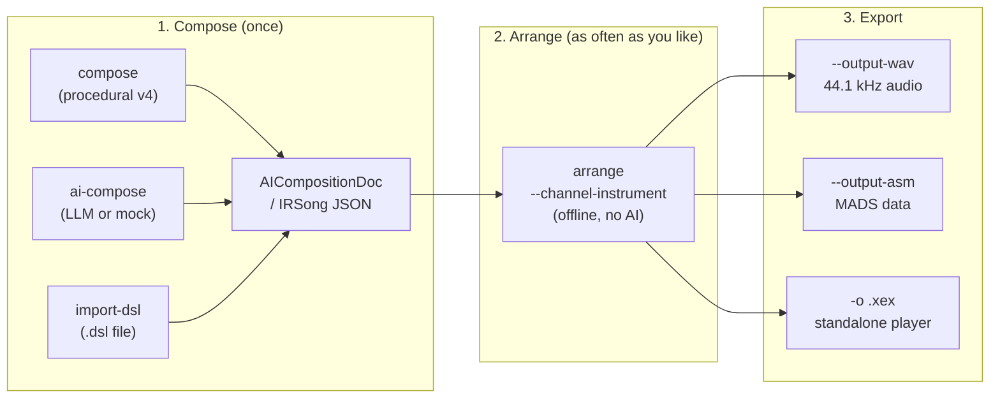

# Composition Workflow

The end-to-end workflow of Atari Music Composer has one defining property: **composition and
instrumentation are independent stages**. Notes, rhythm, and form are decided first; the POKEY
instrument realization is applied later and can be changed at any time without re-composing.



## Step 1 — obtain one composition

Pick one of three interchangeable entry points; all produce the same canonical JSON document:

* **Procedural ([`compose`](procedural-composition.md))** — a deterministic engine with six stylistic
  profiles; identical inputs give identical songs.
* **AI-assisted ([`ai-compose`](ai-composition.md))** — an LLM (or the offline `mock` provider) generates
  a JSON document or a [Music DSL](../reference/music-dsl.md) transcription, validated by a 3-tier
  validator with an automatic repair loop.
* **Import** — `import-json` / `import-dsl` load existing compositions (e.g. the songs in
  `examples/songs/`), validate them, and convert between formats.

See [Composition Formats](composition-formats.md) for the three representations and how they differ.

## Step 2 — save it as JSON

Persist the composition as `AICompositionDoc` JSON or POKEY IR (`IRSong`) JSON (e.g. `-o song.json`).
This file is your musical master copy. The arrangement stage never modifies it.

## Step 3 — iterate on instrumentation

Use [`arrange`](arrangement.md) with `--channel-instrument CH=INSTUMENT_ID` assignments to produce
variants; every arranged output shares the identical musical fingerprint over notes, rests, durations,
volumes, tempo, patterns, and sequence. Export each variant straight to WAV / ASM / XEX. Typical loop:

```bash
python -m atari_music arrange song.json \
  --channel-instrument 1=bass_16bit_pure \
  --channel-instrument 3=lead_attack_bite \
  --channel-instrument 4=perc_kick_tight \
  --program-change-policy replace \
  --output-json variant_a_ir.json \
  --output-wav variant_a.wav \
  -o variant_a.xex
```

## Step 4 — export and verify

Each export path is described in [Export & Atari Playback](export.md):

* `--output-wav` — hardware-accurate 50 Hz frame synthesis at 44.1 kHz.
* `--output-asm` — relocatable MADS data (Structure-of-Arrays) in song format v1 or v2.
* `-o/--output-xex` — a standalone `.xex` executable with the built-in 6502 player, compiled with MADS.

For batch work, `generate_arrangements.py` scores and renders ranked catalog combinations for any single
composition (see [Arrangement](arrangement.md)). The optional
[Studio GUI](studio.md) wraps the same loop with A/B comparison and presets.

## Working with generated music

* `analyze` computes musical and hardware metrics plus a SHA-256 fingerprint, and with `--structure`
  deduces macro form.
* `inspect-instrument` shows full hardware constraints of any catalog instrument before you commit to
  an arrangement.
* Play `.xex` files on real hardware or an emulator (Altirra); the built-in playback screen supports
  per-channel muting with keys `1`–`4`.
